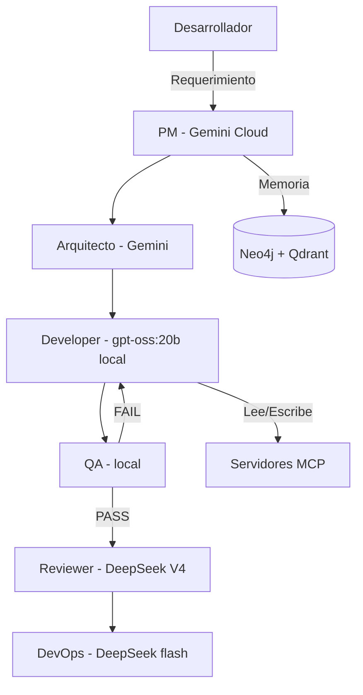

# ADES-AI (Autonomous Development Ecosystem with Artificial Intelligence)


-success.svg)


**ADES-AI** es un ecosistema de desarrollo de software autónomo y multi-agente. Combina la potencia de razonamiento de modelos en la nube con la ejecución rápida y privada de modelos locales, logrando un ahorro del 70-90% en el consumo de tokens.

> 🚀 **¿Quieres ejecutarlo?** Lee la **[Guía de ejecución](docs/guia_ejecucion.md)**.

## 🧠 Arquitectura: 3 cerebros + fábrica multiagente

- **Cerebro 1 — Nube**: Gemini (arquitectura/PM) + DeepSeek V4 vía OpenCode Go (código/review).
- **Cerebro 2 — Local**: `gpt-oss:20b` y `qwen3.8:27b` en la GPU (16 GB, ROCm) vía Ollama.
- **Cerebro 3 — Memoria**: Neo4j + Graphiti (grafo temporal) + Qdrant (vectorial) + Mem0 (hechos) + Cognee (KG documentos).

La **fábrica multiagente** (LangGraph) orquesta: `PM → Arquitecto → Developer ⇄ QA → Reviewer → DevOps`, con bucle cerrado y checkpoint.



## ✨ Capacidades (Fases 0-10 completadas)

- **Cimientos y seguridad** (Fase 0): Docker + rotación de claves + scanner de secretos.
- **Cerebro local** (Fase 1): Ollama + 4 modelos (GPU ROCm).
- **Memoria anti-alucinación** (Fase 2): Graphiti + Mem0 + Cognee + indexador Tree-sitter.
- **Fábrica multiagente** (Fase 3): LangGraph + Reclutador + router (Llama-3.2-3B).
- **Skills y subagentes** (Fase 4): `.opencode/skills/` + subagentes (Explore, Librarian, Oracle).
- **Tool Registry** (Fase 5): catálogo de herramientas integrables.
- **MCP + gateway** (Fase 6): 7 servidores MCP + Bifrost.
- **Optimización de tokens** (Fase 7): prompt/semantic caching + RepoMap + LLMLingua-2.
- **Evaluación** (Fase 8): LLM-as-a-Judge + RAG eval + Langfuse + Promptfoo.
- **Escalado y fine-tuning** (Fase 9): vLLM + OpenHands + Unsloth (documentados).
- **Deuda técnica** (Fase 10): resuelta.

## 📚 Documentación

| Documento | Descripción |
|---|---|
| **[Guía de ejecución](docs/guia_ejecucion.md)** | Cómo instalar y ejecutar el proyecto |
| **[Plan del ecosistema](docs/plan_ecosistema_ia.md)** | Fuente de verdad: visión, roadmap y decisiones |
| **[Catálogo de herramientas](docs/catalogo_herramientas.md)** | Herramientas externas con URLs verificadas |

## ⚡ Arranque rápido

```powershell
pip install -r requirements.txt      # dependencias
docker compose up -d                 # Neo4j + Qdrant + Redis + Bifrost
environment\setup_ollama.ps1         # modelos locales
python -m agents.orquestador "Un endpoint /ping en FastAPI"
```

Ver la **[Guía de ejecución](docs/guia_ejecucion.md)** para el detalle completo.
